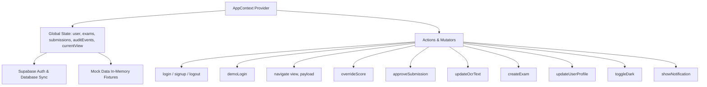
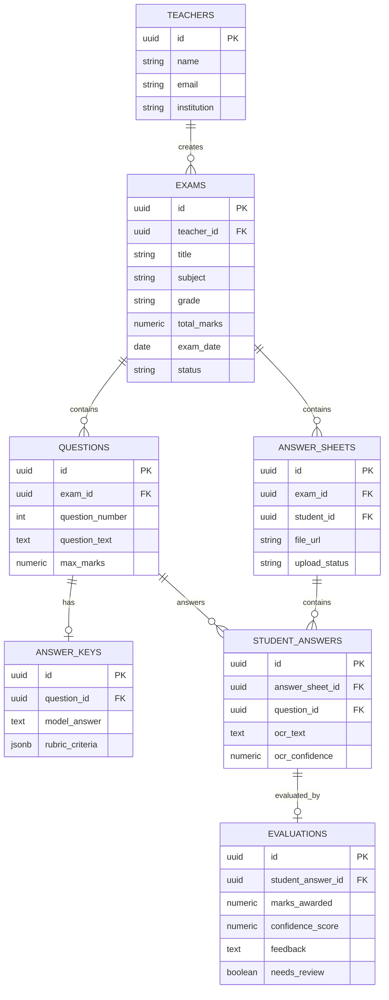

# SmartCheck AI — Project Structure & Architectural Reference

> **Purpose:** This document provides a complete, granular architectural map and reference of the SmartCheck AI codebase for LLMs, developers, and autonomous agents.

---

## 1. High-Level Overview

**SmartCheck AI** is an AI-assisted paper grading and exam evaluation platform tailored for teachers and educational institutions. It facilitates OCR extraction from handwritten student answer sheets, automated rubric-based grading with confidence scoring, teacher-in-the-loop review and manual score overrides, audit logging, and reporting.

### Core Stack
- **Framework / UI:** React 18 (Vite 5 Single-Page Application, JavaScript JSX)
- **Styling:** Tailwind CSS 3.4 + PostCSS + Autoprefixer + Custom CSS Variables
- **Icons:** `lucide-react`
- **Backend / Database / Storage:** Supabase (`@supabase/supabase-js` v2)
  - **Auth:** Supabase Auth (`signInWithPassword`, `signUp`, `signOut`, session listener)
  - **Database:** PostgreSQL (Tables: `teachers`, `exams`, `questions`, `answer_keys`, `answer_sheets`, `student_answers`, `evaluations`)
  - **Storage:** Supabase Storage Bucket (`answer-sheets`)
- **State Management:** React Context API (`AppContext`) with dual-mode support (Live Supabase DB vs. In-Memory Demo Mode)

---

## 2. Directory Tree Map

```
SmartCheck AI/
├── .env.local                     # Supabase URL & Anon Key config
├── .gitignore                     # Git ignore rules (node_modules, dist, logs, etc.)
├── index.html                     # HTML root entrypoint (Google Fonts: Inter, JetBrains Mono)
├── package.json                   # Project dependencies and npm scripts
├── package-lock.json              # Dependency lockfile
├── postcss.config.js              # PostCSS plugins configuration
├── tailwind.config.js             # Tailwind CSS theme configuration (custom colors, fonts, shadows)
├── vite.config.js                 # Vite configuration with @vitejs/plugin-react
├── start.sh                       # Background dev server launch script (logs to dev.log, saves .pid)
├── stop.sh                        # Process termination script (reads .pid or kills Vite process)
├── dev.log                        # Dev server runtime logs (auto-generated)
├── skills-lock.json               # Skill plugin lockfile
│
├── src/
│   ├── main.jsx                   # React root hydration and Provider mounting
│   ├── App.jsx                    # View router shell & authentication gate
│   ├── index.css                  # Global styles, Tailwind directives, dark mode & font tokens
│   │
│   ├── context/
│   │   └── AppContext.jsx         # Central React Context Provider (state, auth, CRUD, dark mode)
│   │
│   ├── data/
│   │   └── mockData.js            # Sample data fixtures for Demo Mode (exams, submissions, audit logs)
│   │
│   ├── lib/
│   │   ├── api.js                 # Supabase DB & Storage CRUD interface layer
│   │   └── supabaseClient.js      # Supabase Client instantiation with fallback credentials
│   │
│   └── components/
│       ├── AuthView.jsx           # Sign-In, Sign-Up & Demo Mode entry screen
│       ├── Sidebar.jsx            # Desktop & mobile navigation drawer
│       ├── TopBar.jsx             # Header bar with search, dark mode toggle & user menu
│       ├── Toast.jsx              # Global notification toast popups
│       ├── DashboardView.jsx      # Metrics overview, quick actions & recent exams
│       ├── ExamsView.jsx          # Filterable exams list with status filters
│       ├── ExamDetailView.jsx     # Exam overview, questions, rubrics & submission list
│       ├── CreateExamWizard.jsx   # 4-step wizard (Details -> Upload -> AI Processing -> Ready)
│       ├── OCRReviewView.jsx      # Split-view OCR text inspection & inline editing
│       ├── ReviewApproveView.jsx  # AI grading review, rubric breakdown, override & approval
│       ├── ResultsView.jsx        # Class performance analytics & question difficulty stats
│       ├── AuditTrailView.jsx     # Chronological log of overrides, approvals & actions
│       ├── ExportView.jsx         # Export reports (CSV, PDF, Excel) & summary tables
│       ├── ProfileView.jsx        # Teacher profile & institutional settings
│       └── generated_profile.html # Static reference mockup for profile view
```

---

## 3. Detailed Component Breakdown

### Core & Layout Components

| File | Type | Description | Key State & Responsibilities |
| :--- | :--- | :--- | :--- |
| `src/main.jsx` | Root Entry | Mounts `<App />` wrapped in `<AppProvider>`. | Injects global context into React root. |
| `src/App.jsx` | App Shell / Router | Gatekeeper for authentication and tab switching. | Reads `isAuthenticated` and `currentView` from `useApp()`. Switches between `AuthView` and `AppShell` views. |
| `src/components/Sidebar.jsx` | Navigation | Left sidebar with view navigation links, active badges, teacher profile footer. | Responsive: Collapsible on mobile, fixed on desktop. Links: Dashboard, Exams, Create Exam, OCR Review, Grading Review, Results, Audit Trail, Export, Settings. |
| `src/components/TopBar.jsx` | Header | Top navigation bar with breadcrumb trail, global search input, dark mode toggle, notification dropdown, and user menu. | Dispatches `toggleDark`, calls `logout`, handles search filter state. |
| `src/components/Toast.jsx` | Notification UI | Renders animated toast popups for user feedback. | Listens to `notification` state (`{ message, type: 'info'\|'success'\|'error' }`) with 3s timeout. |

---

### Application Views (`src/components/`)

#### 1. `AuthView.jsx`
- **Purpose:** User authentication interface.
- **Features:** 
  - Dual tabs: "Sign In" and "Sign Up".
  - One-click "Try Demo Mode" button to explore without Supabase credentials.
  - Form validation with feedback banners.
  - Calls `login(email, password)`, `signup(name, email, password)`, or `demoLogin()`.

#### 2. `DashboardView.jsx`
- **Purpose:** Main landing overview for teachers.
- **Features:**
  - KPI Stat Cards: Total Exams, Submissions Evaluated, Pending Review, Average AI Confidence.
  - Quick Action Buttons: Create New Exam, Upload Answer Sheets, Audit Logs.
  - Active Exams Table with status tags (`Completed`, `Processing`, `Draft`), evaluation progress bars, and navigation links.

#### 3. `ExamsView.jsx`
- **Purpose:** Full catalog of all created exams.
- **Features:**
  - Search bar and status filters (All, Completed, Processing, Draft).
  - Cards / Table rows displaying subject, grade, date, total students, evaluated count, and average score.
  - Quick action to open `ExamDetailView` or delete/archive.

#### 4. `ExamDetailView.jsx`
- **Purpose:** Single exam management hub.
- **Features:**
  - Exam metadata banner (Title, Subject, Total Marks, Date, Status).
  - Two Tabs:
    - **Questions & Rubrics:** Lists exam questions, maximum marks, and reference model answer criteria.
    - **Student Submissions:** Renders student submission list, status badges, total marks, confidence indicator, and direct action buttons ("Review OCR" / "Grade & Approve").

#### 5. `CreateExamWizard.jsx`
- **Purpose:** Multi-step wizard to create an exam, define questions, and ingest answer sheets.
- **Steps:**
  - **Step 1 (Details & Questions):** Exam title, subject, grade, max score, dynamic question builder (question text, marks, rubric/criteria).
  - **Step 2 (Upload Sheets):** Drag-and-drop file uploader for scanned answer sheets (PDF/JPG/PNG).
  - **Step 3 (AI Processing):** Animated processing progress bar simulating OCR digitization and AI evaluation.
  - **Step 4 (Completion):** Confirmation screen with direct navigation to OCR Review or Exam Details.

#### 6. `OCRReviewView.jsx`
- **Purpose:** Teacher-in-the-loop OCR verification and correction.
- **Features:**
  - Split-screen layout: Scanned answer sheet image/document on the left, recognized text on the right.
  - Confidence indicators per question block.
  - Inline text editor enabling teachers to fix OCR errors before AI scoring.
  - Calls `updateOcrText(submissionId, questionId, newText)` which persists to Supabase or local state.

#### 7. `ReviewApproveView.jsx`
- **Purpose:** AI Grading Review & Human Approval Interface.
- **Features:**
  - Per-question breakdown showing:
    - Student handwritten OCR transcript.
    - Reference Rubric / Model Answer.
    - AI Suggested Score & Confidence Score badge (Color-coded: Green $\ge 90\%$, Yellow $75-89\%$, Red $< 75\%$).
    - AI Explanation & Reasoning bullet points.
    - Teacher Score Override input field & feedback note.
  - "Approve & Finalize" action button that marks submission as approved, updates total score, and writes to audit log.

#### 8. `ResultsView.jsx`
- **Purpose:** Class-wide analytics and performance insights.
- **Features:**
  - Grade distribution chart (A, B, C, D, F counts).
  - Question-by-question difficulty and average score breakdown.
  - Highest and lowest scoring question identifiers.
  - Summary metrics: Pass Rate, Class Average, Highest Score.

#### 9. `AuditTrailView.jsx`
- **Purpose:** Compliance and transparency log.
- **Features:**
  - Chronological timeline of all system and user activities.
  - Categorized events: Teacher Score Overrides, OCR Edits, Evaluations Approved, Exams Created, Logins.
  - Displays Timestamp, Actor Name, Actor Role, Exam Title, Severity tag (`info`, `warning`, `success`), and detailed notes.

#### 10. `ExportView.jsx`
- **Purpose:** Grade report generation and download.
- **Features:**
  - Export options: CSV (Spreadsheet), PDF (Grade Sheets), Excel format simulation.
  - Filter by Exam, Grade, and Approval status.
  - Table preview with export trigger.

#### 11. `ProfileView.jsx`
- **Purpose:** Teacher account and institutional configuration.
- **Features:**
  - Personal Information: Name, Email, Institution/School, Academic Year.
  - Grading Preferences: AI Confidence threshold for auto-flagging, default grading strictness.
  - Persistence: Updates Supabase `teachers` table via `updateTeacherProfile()`.

---

## 4. State Management Architecture (`src/context/AppContext.jsx`)

The application uses React Context to provide a unified reactive state layer across both **Live Supabase DB** mode and **Demo Mode**.



### Key Context State Variables:
- `isAuthenticated` (`boolean`): Whether user is logged in.
- `user` (`object`): Active user info (`id`, `name`, `email`, `role`, `school`, `academicYear`).
- `isDemo` (`boolean`): Flags whether the app is running in Mock Demo Mode vs Live Supabase Mode.
- `currentView` (`string`): Active navigation route (`'dashboard'`, `'exams'`, `'exam-detail'`, `'create-exam'`, `'ocr-review'`, `'review-approve'`, `'results'`, `'audit'`, `'export'`, `'settings'`).
- `activeExam` (`object | null`): Currently selected exam for detail/review views.
- `activeSubmission` (`object | null`): Currently selected submission for grading/OCR review.
- `exams` (`array`): List of exams.
- `submissions` (`array`): List of student answer submissions.
- `auditEvents` (`array`): List of audit log entries.
- `isDark` (`boolean`): Dark mode state toggling `.dark` class on root `<html>`.
- `notification` (`object | null`): Active toast notification.

---

## 5. API Layer & Database Schema (`src/lib/api.js`)

The `src/lib/api.js` module wraps all Supabase Postgres queries and Storage calls.

### Supabase Table Relationships



### Exported API Functions in `src/lib/api.js`:
- `fetchTeacherExams(teacherId, isDemo)`: Fetches exams ordered by creation date from `exams` table.
- `createExamInDB(examData, teacherId)`: Inserts record into `exams`, `questions`, and `answer_keys`.
- `uploadAnswerSheetDB(examId, file, studentId)`: Uploads file to Supabase Storage bucket `answer-sheets` and inserts into `answer_sheets` table.
- `saveStudentAnswerOCR(answerSheetId, questionId, ocrText, ocrConfidence)`: Upserts transcription into `student_answers`.
- `saveEvaluationDB(studentAnswerId, marksAwarded, confidenceScore, feedback, needsReview)`: Inserts AI evaluation / teacher override into `evaluations`.
- `updateTeacherProfile(teacherId, profileData)`: Updates teacher details in `teachers` table.

---

## 6. Styling & Theme Tokens

- **Tailwind Config (`tailwind.config.js`):**
  - Custom Color Palette:
    - `primary`: `#2563eb` (Blue-600)
    - `primary-dark`: `#1d4ed8` (Blue-700)
    - `accent`: `#8b5cf6` (Purple-500)
    - `success`: `#10b981` (Emerald-500)
    - `warning`: `#f59e0b` (Amber-500)
    - `danger`: `#ef4444` (Red-500)
    - `background`: CSS variable-based (`hsl(var(--background))`)
    - `surface`: Dark/light surface containers (`hsl(var(--surface))`)
  - Typography:
    - Sans font: Inter, sans-serif
    - Mono font: JetBrains Mono, monospace
- **Global CSS (`src/index.css`):**
  - Includes CSS root variables for light and dark theme styling.
  - Custom scrollbar styling and glassmorphism helpers (`.glass-panel`).

---

## 7. Development & Operational Scripts

| Script / Command | Purpose |
| :--- | :--- |
| `npm run dev` | Runs Vite local development server on `http://localhost:5173`. |
| `npm run build` | Builds optimized production bundle into `dist/`. |
| `npm run preview` | Previews production build locally. |
| `./start.sh` | Launches dev server in the background, writes stdout/stderr to `dev.log`, records PID in `.pid`. |
| `./stop.sh` | Safely stops background dev server process using `.pid` or port lookup. |

---

## 8. Guidance for LLMs Modifying this Codebase

1. **Dual Mode Preservation:** When modifying data operations in components or `AppContext`, ensure both **Live Supabase** and **Demo Mode** (`isDemo === true`) branches are handled gracefully without breaking mock workflows.
2. **View Navigation:** Routing is state-driven via `currentView` in `AppContext.jsx`. Use `navigate('view-name', { exam, submission })` rather than `react-router` URL paths.
3. **Audit Trail Logging:** Any critical teacher action (score overrides, OCR text edits, approvals) should create an event and append to `auditEvents` via `AppContext.jsx`.
4. **Supabase Schema Consistency:** Keep column names aligned with `api.js` snake_case database schema (`teacher_id`, `total_marks`, `ocr_text`, `marks_awarded`, etc.).
