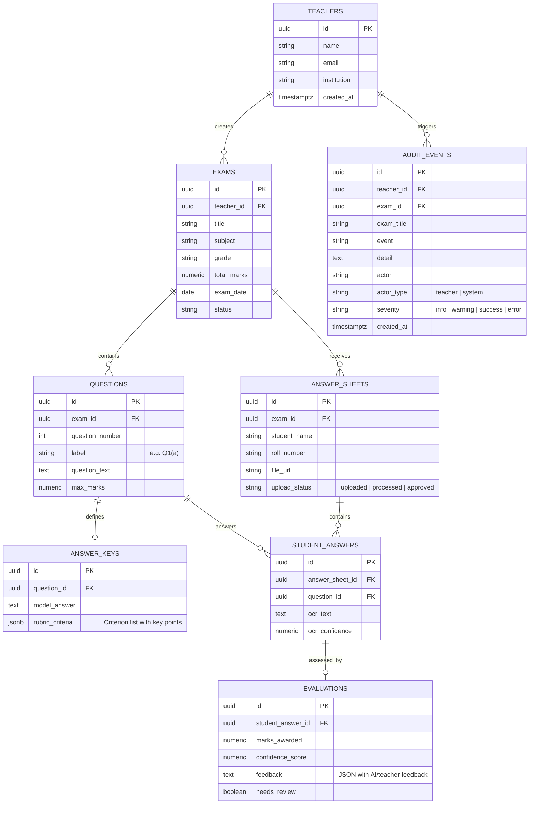

# SmartCheck AI — Project Structure & Architectural Reference

> **Purpose:** This document provides a comprehensive, granular architectural map and reference of the complete SmartCheck AI codebase for LLMs, developers, and autonomous agents.

---

## 1. High-Level System Architecture

**SmartCheck AI** is a dual-tier (React SPA + FastAPI Backend) agentic AI system for automated evaluation of handwritten student answer sheets. It combines local neural NLP models with Google Gemini Vision models to achieve high accuracy while providing teachers with confidence scores, transparent criterion-level grading rationale, and a human-in-the-loop review queue.

```
                      ┌───────────────────────────────────────┐
                      │        Teacher / Web Browser          │
                      │  React 18 + Vite + Tailwind CSS SPA   │
                      │        (http://localhost:5173)        │
                      └──────────────┬──────────────────┬─────┘
                                     │                  │
                Client Supabase SDK  │                  │ REST API Calls
             (Auth, Tables, Storage) │                  │ (OCR, Grading, KB)
                                     ▼                  ▼
                    ┌──────────────────┐    ┌────────────────────────────────────────┐
                    │  Supabase Cloud  │    │            FastAPI Backend             │
                    │  - PostgreSQL    │    │        (http://127.0.0.1:8000)         │
                    │  - Auth (JWT)    │    ├────────────────────────────────────────┤
                    │  - Storage Bucket│    │ - /ocr/*                               │
                    │    'answer-sheets│    │ - /knowledge/build & /rebuild          │
                    └──────────────────┘    │ - /evaluation/evaluate                 │
                                            │ - /concepts/extract                    │
                                            │ - /feedback/generate                   │
                                            └──────────────────┬─────────────────────┘
                                                               │ Orchestrates
                                                               ▼
                             ┌────────────────────────────────────────────────────────┐
                             │                  AI Agent Pipeline                     │
                             ├────────────────────────────────────────────────────────┤
                             │ 1. OCR Agent (Gemini 3.5 Flash + RapidOCR ONNX)        │
                             │ 2. Concept Agent (Answer Key Parser + Knowledge Builder│
                             │ 3. Evaluation Agent (all-MiniLM-L6-v2 + Gemini Scorer) │
                             │ 4. Feedback Agent (Criterion Justifications)           │
                             └────────────────────────────────────────────────────────┘
```

### Technology Stack
- **Frontend:** React 18, Vite 5, Tailwind CSS 3.4, PostCSS, `lucide-react`, ESLint 8.
- **Backend Server:** FastAPI, Uvicorn, Python 3.11 (`backend/venv`).
- **Database & Storage:** Supabase PostgreSQL with Row Level Security (RLS), Supabase Storage (`answer-sheets` bucket).
- **Local Machine Learning / NLP:**
  - `sentence-transformers/all-MiniLM-L6-v2` for semantic similarity & concept coverage.
  - `KeyBERT` for keyword extraction.
  - `rapidocr-onnxruntime` + `paddleocr` for fallback OCR.
  - `PyMuPDF` (fitz) & `python-docx` for document parsing.
- **Cloud LLM / Multimodal Vision:** Google Gemini REST API (`gemini-3.5-flash` for vision/handwriting OCR, `gemini-flash-lite-latest` for text tasks).

---

## 2. Directory Tree Map

```
SmartCheckAI/
├── .env.local                          # Frontend Supabase URL & Anon Key config
├── .eslintrc.cjs                       # ESLint configuration (React, hooks, refresh)
├── .gitignore                          # Git ignore rules (node_modules, venv, .env, pid)
├── index.html                          # HTML entrypoint (Inter, JetBrains Mono fonts)
├── package.json                        # Frontend dependencies & npm scripts
├── package-lock.json                   # NPM lockfile
├── postcss.config.js                   # PostCSS Tailwind config
├── tailwind.config.js                  # Tailwind theme tokens & color definitions
├── vite.config.js                      # Vite React plugin configuration
├── start.sh                            # Launches FastAPI (:8000) + Vite (:5173) in background
├── stop.sh                             # Gracefully terminates backend and frontend processes
├── backend.log                         # FastAPI stdout/stderr logs (auto-generated)
├── frontend.log                        # Vite stdout/stderr logs (auto-generated)
├── PROJECT_PROGRESS_REPORT.md          # Comprehensive progress and milestone report
├── PROJECT_STRUCTURE.md                # This architectural reference file
│
├── agents/                             # Python AI Agents Module
│   ├── ocr_agent/                      # Document transcription & vision OCR
│   │   ├── gemini_ocr.py               # Gemini 3.5 Flash Vision OCR with question splitting
│   │   ├── ocr.py                      # RapidOCR ONNX local fallback engine
│   │   ├── preprocessing.py            # Image deskewing, grayscale & contrast adjustments
│   │   └── segmentation.py             # Sub-question bounding box & label segmentation
│   │
│   ├── concept_agent/                  # Answer key parsing & knowledge base extraction
│   │   ├── answer_key.py               # Multi-format (PDF/DOCX/TXT) question-labeled text extractor
│   │   ├── knowledge_builder.py        # Links answer key points to rubric criteria with weights
│   │   ├── knowledge_base.py           # In-memory and cached knowledge store
│   │   └── concept_extractor.py        # KeyBERT concept/keyword extraction fallback
│   │
│   ├── evaluation_agent/               # Multi-criteria scoring & confidence evaluation
│   │   ├── scorer.py                   # Hybrid criterion-wise scorer (local embeddings + Gemini)
│   │   ├── concept_matcher.py          # Sentence-transformer cosine similarity matcher
│   │   ├── semantic_matcher.py         # Rubric-to-answer semantic alignment engine
│   │   └── confidence.py               # Aggregated confidence score & review queue flagger
│   │
│   └── feedback_agent/                 # Constructive student & teacher feedback synthesis
│       └── feedback_generator.py       # Criterion "Covered/Missed" justifications & suggestions
│
├── backend/                            # FastAPI Server Application
│   ├── main.py                         # Application entrypoint, CORS setup, router mounts, /health
│   ├── requirements.txt                # Python dependencies (123 packages installed in venv)
│   ├── .env                            # Backend Supabase URL, Key & GEMINI_API_KEY
│   │
│   ├── config/
│   │   └── supabase_client.py          # Supabase client instantiation for backend tasks
│   │
│   ├── migrations/                     # PostgreSQL Migrations (Verified in Supabase)
│   │   ├── 001_add_question_label.sql  # Adds 'label' to questions table
│   │   ├── 002_add_answer_sheet_student_fields.sql  # Adds student_name & roll_number
│   │   ├── 003_create_audit_events.sql # Creates audit_events table with RLS
│   │   └── 004_add_answer_key_knowledge.sql # Adds rubric_criteria JSONB to answer_keys
│   │
│   └── routes/                         # API Route Handlers
│       ├── ocr_routes.py               # /ocr/image, /ocr/pdf, /ocr/batch endpoints
│       ├── knowledge_routes.py         # /knowledge/build, /knowledge/rebuild endpoints
│       ├── evaluation_routes.py        # /evaluation/evaluate (sheet-level batch grading)
│       ├── concept_routes.py           # /concepts/extract endpoint
│       └── feedback_routes.py          # /feedback/generate endpoint
│
└── src/                                # Frontend React Application
    ├── main.jsx                        # React root hydration and Provider mounting
    ├── App.jsx                         # Main view router shell & authentication gate
    ├── index.css                       # Global CSS, Tailwind base, dark mode tokens
    │
    ├── context/
    │   └── AppContext.jsx              # Global state provider (auth, exams, submissions, audit)
    │
    ├── data/
    │   └── mockData.js                 # In-memory mock datasets for Demo Mode
    │
    ├── lib/
    │   ├── api.js                      # Supabase DB & Storage CRUD interface
    │   ├── backendApi.js               # Client wrapper for FastAPI backend endpoints
    │   ├── grading.js                  # Frontend grading math, rounding & badge helpers
    │   ├── pipeline.js                 # Orchestrates end-to-end evaluation flow
    │   ├── exportResults.js            # CSV generation & formatted print/PDF layout helpers
    │   └── supabaseClient.js           # Supabase client instance with fallback
    │
    └── components/                     # UI Views & Specialized Subcomponents
        ├── AuthView.jsx                # Login, Signup, and 1-Click Demo Mode selector
        ├── Sidebar.jsx                 # Desktop & mobile navigation drawer
        ├── TopBar.jsx                  # Navigation breadcrumbs, dark mode toggle, search
        ├── Toast.jsx                   # Notification toast messages
        ├── ErrorBoundary.jsx           # React UI crash protection wrapper
        │
        ├── DashboardView.jsx           # Main stats overview, KPI metrics, recent exams
        ├── ExamsView.jsx               # Catalog of exams with status filters
        ├── ExamDetailView.jsx          # Questions, rubrics, and submission roster
        ├── CreateExamWizard.jsx        # 4-step wizard: Details -> Questions -> Upload -> Ready
        ├── AnswerKeyStep.jsx           # Wizard step: Answer key upload & text extraction
        ├── KnowledgeReviewStep.jsx     # Wizard step: Visual rubric criteria & key points editor
        ├── CriteriaEditor.jsx          # Reusable criterion weights & point mapping widget
        │
        ├── EvaluatePapersView.jsx      # Bulk paper upload & live evaluation progress monitor
        ├── OCRReviewView.jsx           # Split-view image vs. transcription inspector/editor
        ├── ReviewApproveView.jsx       # Student report card, criterion breakdown, teacher override
        ├── ReviewQueueView.jsx         # Isolated queue for low-confidence / flagged submissions
        ├── ClassAnalysisView.jsx       # Question analytics, score distributions, missed concepts
        ├── ResultsView.jsx             # Class performance overview & grade stats
        ├── AuditTrailView.jsx          # Chronological log of teacher overrides & actions
        ├── ExportView.jsx              # Gradebook export (CSV, PDF, Excel)
        └── ProfileView.jsx             # Teacher settings, school info & grading thresholds
```

---

## 3. Agent System Architecture (`agents/`)

### 1. OCR Agent (`agents/ocr_agent/`)
- **Primary:** `gemini_ocr.py` uses Gemini 3.5 Flash Vision. It receives both the answer sheet image/PDF and the list of expected question labels (`Q1(a)`, `Q1(b)`, etc.), transcribing handwritten responses directly partitioned by question.
- **Fallback:** `ocr.py` utilizes local `rapidocr-onnxruntime` with OpenCV preprocessing (`preprocessing.py` for deskewing, adaptive binarization, and noise suppression).
- **Confidence:** Emits a character/word-level confidence score ($0.0 - 1.0$) per transcribed answer.

### 2. Concept Agent (`agents/concept_agent/`)
- **Answer Key Reader (`answer_key.py`):** Ingests PDF (`fitz`), Word (`docx`), or text files. Uses regular expressions to detect question headers (`Q1(a)`, `Ans 2:`, `1.b)`) and split model answers accordingly. Falls back to Gemini text parsing for unconventional formatting.
- **Knowledge Builder (`knowledge_builder.py`):** Breaks model answers into atomic concept points and maps them to rubric criteria. Computes credit allocation per key point.

### 3. Evaluation Agent (`agents/evaluation_agent/`)
- **Hybrid Scorer (`scorer.py`):** For each question criterion:
  1. **Concept Matcher (`concept_matcher.py`):** Compares student answer sentences to answer-key key points using `sentence-transformers/all-MiniLM-L6-v2`. Scores $\ge 0.60$ count as covered; $0.45 - 0.59$ count as partially covered.
  2. **Semantic Matcher (`semantic_matcher.py`):** Computes holistic semantic alignment between the student answer and the criterion definition.
  3. **Local Score Calculation:** $0.60 \times \text{Concept Coverage} + 0.40 \times \text{Semantic Match}$, rounded to 0.5 marks.
  4. **Gemini Second Opinion:** A batched sheet-level LLM call generates an independent score and reasoning. Final criterion score is the average of local and Gemini scores.
- **Confidence Engine (`confidence.py`):** Combines OCR transcription confidence with inter-model agreement. If confidence $< 0.75$ or local vs. Gemini discrepancy $> 30\%$, the submission is flagged for human review (`needs_review = true`).

### 4. Feedback Agent (`agents/feedback_agent/`)
- Synthesizes clear explanations per criterion:
  - Highlights covered concepts (e.g., *"Identified Volume, Velocity, Variety"*).
  - Pinpoints missing concepts (e.g., *"Missed Veracity and Value"*).
  - Formulates actionable student guidance.

---

## 4. Backend API Endpoints (`backend/routes/`)

| Method | Endpoint | Description |
| :--- | :--- | :--- |
| `GET` | `/health` | Server health check and status verification |
| `POST` | `/ocr/image` | Runs OCR on single/multi-page image files |
| `POST` | `/ocr/pdf` | Extracts and performs OCR on PDF documents |
| `POST` | `/knowledge/build` | Splits answer key document and extracts rubric criteria key points |
| `POST` | `/knowledge/rebuild` | Recalculates key points for edited model answers |
| `POST` | `/evaluation/evaluate` | Evaluates complete student submission (local NLP + Gemini batch) |
| `POST` | `/concepts/extract` | KeyBERT keyword and concept extraction |
| `POST` | `/feedback/generate` | Generates targeted feedback from covered/missed concept lists |

---

## 5. Database Schema & Tables



---

## 6. Frontend Application Views

| View Component | Purpose | Key Capabilities |
| :--- | :--- | :--- |
| `AuthView.jsx` | User Access | Email/password sign-in, signup, 1-click Demo Mode. |
| `DashboardView.jsx` | Overview | KPI metrics cards, active exams progress, quick action buttons. |
| `ExamsView.jsx` | Exam List | Filterable and searchable catalog of exams with status badges. |
| `ExamDetailView.jsx` | Exam Hub | View questions, rubrics, and student submission roster. |
| `CreateExamWizard.jsx` | Setup Wizard | 4-step wizard: Exam Details, Questions & Rubrics, Answer Key, Knowledge Review. |
| `AnswerKeyStep.jsx` | Key Ingestion | Uploads PDF/DOCX/TXT answer keys, parses into question sections. |
| `KnowledgeReviewStep.jsx`| Knowledge Base | Interactive review of model answers, criteria weights, and key concepts. |
| `EvaluatePapersView.jsx` | Bulk Processing | Drag-and-drop batch upload with real-time per-paper grading pipeline progress. |
| `OCRReviewView.jsx` | OCR Verification | Split-screen visual editor comparing scanned sheet with transcribed text. |
| `ReviewApproveView.jsx` | Evaluation Report | Detailed student grading report, criterion breakdowns, score overrides, PDF export. |
| `ReviewQueueView.jsx` | Flagged Review | Focused queue showing only low-confidence or high-discrepancy answers. |
| `ClassAnalysisView.jsx` | Class Analytics | Question difficulty, score distributions, and most frequently missed concepts. |
| `ResultsView.jsx` | Summary Stats | Class-wide average scores, pass rates, and grade distribution charts. |
| `ExportView.jsx` | Gradebook Export | Exports CSV, printable grade sheets, and consolidated PDF reports. |
| `AuditTrailView.jsx` | Compliance Log | Chronological ledger of all grading runs, score overrides, and approvals. |
| `ProfileView.jsx` | Teacher Settings | Institutional details, AI confidence threshold controls, grading strictness. |

---

## 7. Operational Scripts & Commands

```bash
# Start both FastAPI backend (:8000) and Vite frontend (:5173) in background
./start.sh

# Terminate both servers cleanly
./stop.sh

# View live runtime logs
tail -f frontend.log
tail -f backend.log

# Run frontend tests / linting
npm run lint
npm run build

# Direct backend manual startup (from project root)
./backend/venv/bin/uvicorn backend.main:app --host 127.0.0.1 --port 8000 --reload
```

---

## 8. Development & Architectural Guidelines

1. **Dual-Mode Preservation:** All frontend views and data calls in `AppContext.jsx` and `src/lib/api.js` must support both **Live Supabase Mode** and **In-Memory Demo Mode** (`isDemo === true`).
2. **Criterion-Wise Grading Integrity:** Do not revert to coarse monolithic grading. Always grade against individual rubric criteria with explicit key-point justifications.
3. **Teacher-in-the-Loop Authority:** Automated marks are suggestions. Teacher score overrides must always take precedence and be logged to `audit_events`.
4. **Environment Variables:**
   - Frontend: `VITE_SUPABASE_URL`, `VITE_SUPABASE_ANON_KEY` in `.env.local`.
   - Backend: `SUPABASE_URL`, `SUPABASE_KEY`, `GEMINI_API_KEY`, `GEMINI_MODEL`, `GEMINI_TEXT_MODEL` in `backend/.env`.
